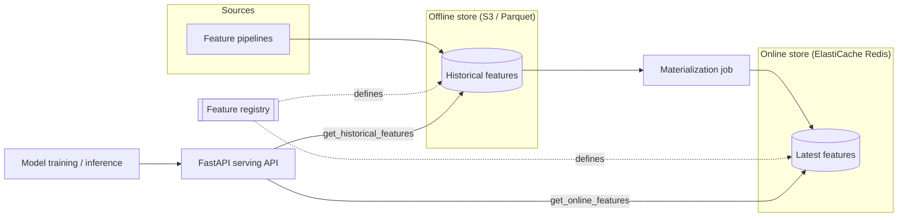

# Feature Store Platform

[](LICENSE)
[](https://github.com/abhisheksawant52/feature-store-platform/actions/workflows/ci.yml)
[](https://www.python.org/)
[](https://fastapi.tiangolo.com/)
[](https://github.com/psf/black)

A feature store for machine learning: offline (historical) and online
(low-latency) feature storage, offline-to-online materialization, and a
feature-serving API built with FastAPI.

## Overview

Machine learning teams need the *same* feature values available in two very
different access patterns: cheap, point-in-time-correct history for building
training datasets, and single-digit-millisecond lookups for real-time
inference. Keeping those two paths consistent — same definitions, same join
keys, same freshness guarantees — is the core problem a feature store solves.

This platform provides a small, coherent implementation of that pattern. A
central **registry** describes entities and feature views; an **offline store**
(Parquet on S3) holds full history; an **online store** (Redis / ElastiCache)
holds the latest value per entity; and **materialization** jobs keep the online
store in sync. A FastAPI service exposes online retrieval and registry
inspection over HTTP.

It is aimed at ML platform and MLOps engineers who want a realistic, deployable
reference: containerized, Helm-packaged, and backed by Terraform-provisioned
AWS infrastructure.

## Architecture



Components:

- **Registry** (`feature_store.registry`) — entities, feature views, and
  `view:feature` reference resolution.
- **Offline store** (`feature_store.offline_store`) — Parquet-backed historical
  retrieval with point-in-time-correct joins.
- **Online store** (`feature_store.online_store`) — Redis and in-memory backends.
- **Materialization** (`feature_store.materialization`) — offline → online sync.
- **Serving** (`feature_store.serving`) + **API** (`feature_store.api`) — the
  `get_online_features` / `get_historical_features` logic and HTTP routes.

## Features

- Registry-driven feature views and entities with typed features.
- Point-in-time-correct historical retrieval for training datasets.
- Low-latency online serving with Redis (in-memory backend for local/dev).
- Offline-to-online materialization with configurable TTLs.
- FastAPI service with `/health`, `/ready`, and versioned `/api/v1` routes.
- Production packaging: multi-stage non-root Docker image, Helm chart, and
  Terraform for AWS (S3, ECR, ElastiCache Redis).

## Tech Stack

Python 3.11+ · FastAPI · Uvicorn · Pydantic v2 · Redis · pandas · PyArrow ·
Docker · Helm · Terraform (AWS) · GitHub Actions

## Getting Started

### Prerequisites

- Python 3.11 or newer
- `make` (optional, for convenience targets)
- Docker, Helm, and Terraform (optional, for packaging and infra)

### Install

```bash
python -m venv .venv && source .venv/bin/activate
make install            # pip install -e ".[dev]"
```

### Configuration

```bash
cp .env.example .env    # adjust values as needed
```

### Run

```bash
uvicorn feature_store.main:app --reload --port 8000

# In another shell:
curl localhost:8000/health
curl localhost:8000/api/v1/feature-views
curl -X POST localhost:8000/api/v1/get-online-features \
  -H 'content-type: application/json' \
  -d '{"features":["customer_activity:transactions_7d"],"entities":[{"customer_id":42}]}'
```

## Project Structure

```
.
├── src/feature_store/
│   ├── main.py               # FastAPI app factory + router wiring
│   ├── config.py             # pydantic-settings configuration
│   ├── logging_config.py     # structured logging setup
│   ├── registry.py           # entities, feature views, resolution
│   ├── offline_store.py      # Parquet historical retrieval
│   ├── online_store.py       # Redis / in-memory lookups
│   ├── materialization.py    # offline -> online jobs
│   ├── serving.py            # get_online / get_historical features
│   └── api/                  # health + feature routers, DI wiring
├── tests/                    # pytest suite (TestClient + unit)
├── helm/feature-store/       # Helm chart (deployment, svc, ingress, hpa, ...)
├── terraform/                # AWS infra: S3, ECR, ElastiCache module
│   ├── modules/online-store/ # ElastiCache Redis replication group
│   └── environments/{dev,prod}
├── Dockerfile                # multi-stage, non-root, HEALTHCHECK /health
└── .github/workflows/ci.yml  # lint, test, docker, terraform, helm
```

## Configuration

All settings are read from environment variables prefixed with
`FEATURE_STORE_` (see [`.env.example`](.env.example)).

| Variable                            | Default                          | Description                              |
| ----------------------------------- | -------------------------------- | ---------------------------------------- |
| `FEATURE_STORE_ENVIRONMENT`         | `development`                    | Deployment environment name.             |
| `FEATURE_STORE_LOG_LEVEL`           | `INFO`                           | Logging verbosity.                       |
| `FEATURE_STORE_PORT`                | `8000`                           | HTTP listen port.                        |
| `FEATURE_STORE_REDIS_URL`           | `redis://localhost:6379/0`       | Online store (Redis) connection URL.     |
| `FEATURE_STORE_REDIS_KEY_PREFIX`    | `fs`                             | Namespace prefix for online keys.        |
| `FEATURE_STORE_ONLINE_TTL_SECONDS`  | `86400`                          | Default online feature TTL.              |
| `FEATURE_STORE_OFFLINE_STORE_URI`   | `s3://feature-store/offline`     | Offline store base URI.                  |
| `FEATURE_STORE_OFFLINE_STORE_FORMAT`| `parquet`                        | Offline store file format.               |

## Deployment

### Container

```bash
make docker-build       # docker build -t feature-store-platform:local .
```

### Kubernetes (Helm)

```bash
helm lint helm/feature-store
helm upgrade --install feature-store helm/feature-store \
  --set image.tag=0.1.0 \
  --set redis.existingSecret=feature-store-redis
```

The chart ships a Deployment, Service (port 8000), Ingress, HPA,
ServiceAccount, ConfigMap, and a Redis secret placeholder.

### Infrastructure (Terraform)

```bash
cd terraform
terraform init -backend-config=environments/dev/backend.hcl
terraform plan  -var-file=environments/dev/terraform.tfvars
```

Provisions an S3 bucket (offline store), an ECR repository, and an ElastiCache
Redis replication group (online store) via `modules/online-store`.

## Contributing

Contributions are welcome — see [CONTRIBUTING.md](CONTRIBUTING.md) and our
[Code of Conduct](CODE_OF_CONDUCT.md).

## Security

Please report vulnerabilities as described in [SECURITY.md](SECURITY.md).

## License

Released under the [MIT License](LICENSE).
